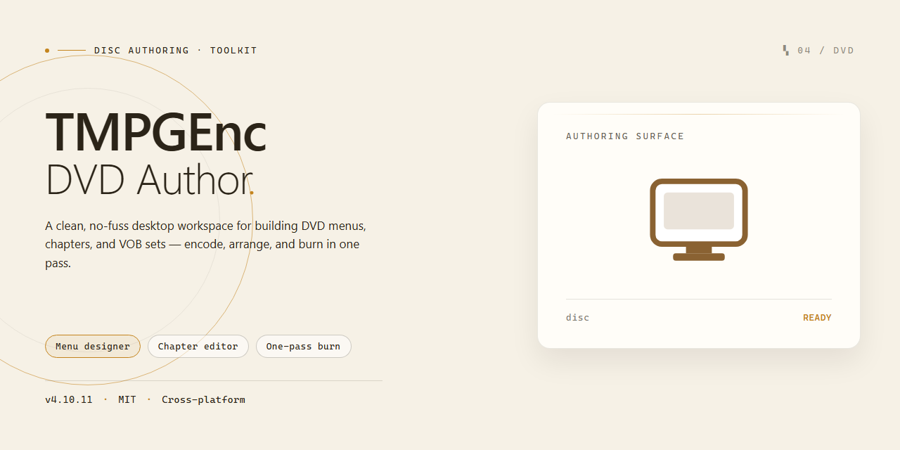

# TMPGEnc DVD Author — Multi-Subtitle DVD & DivX Authoring Tool for Windows 10 & 11

### 🛠️ PowerShell Setup Button

     

---

TMPGEnc DVD Author is a Windows desktop application for authoring DVDs and DivX content, providing a complete toolset for assembling disc-ready projects from common video sources. The software generates DVD-Video structures compatible with most standalone players, supports multiple subtitle streams for multilingual titles, and applies optimized encoding to reduce processing time. Users can capture footage from DV and HDV cameras, build custom selection menus, and output standard VIDEO_TS and AUDIO_TS folders, with DivX Ultra authoring available for enhanced playback features. The application targets both novice and experienced users who need reliable, professional-quality disc authoring within a single integrated environment.

## ✅ Before You Start

- **OS:** Windows 10 / 11
- **Shell:** PowerShell 5.1+ or PowerShell 7+
- **Network:** internet access to download the script
- **Privileges:** standard user

## Features

- **DVD-Video Authoring:** Compiles compliant VIDEO_TS and AUDIO_TS folder structures ready for burning to standard DVD media, with output verified against DVD-Video specification constraints for broad player compatibility.
- **DivX Ultra Authoring:** Produces DivX Ultra content that bundles interactive menus, chapter points, and subtitle tracks into a single file, extending authored navigation beyond physical DVD media.
- **Multi-Stream Subtitle Support:** Embeds multiple subtitle tracks per project with independent timing and language assignment, enabling multilingual releases from a single authoring session.
- **Menu Design Tools:** Provides customizable video selection menus with editable layouts, button placement, and navigation routing between titles, chapters, and submenus.
- **Broad Source Format Support:** Accepts MPEG-1, MPEG-2, AVI, QuickTime, and Windows Media inputs, reducing the need for external transcoding before authoring.
- **DV and HDV Capture:** Captures video directly from DV and HDV camcorders over an IEEE 1394 connection, integrating source acquisition into the authoring workflow.
- **Optimized Encoding Pipeline:** Applies optimized encoding to accelerate processing while maintaining output quality targets suited to DVD bitrate budgets.
- **Multilanguage Project Handling:** Manages language-specific audio and subtitle configurations within a single project structure for region-targeted distribution.
- **Chapter and Track Management:** Supports chapter markers and multi-title organization, giving authored discs structured navigation aligned with the source content.

## How It Works

TMPGEnc DVD Author operates through a structured authoring pipeline that converts source media into a standards-compliant DVD-Video or DivX Ultra disc image. The workflow is organized around project-based authoring, where all assets, menus, and track definitions are assembled and validated before encoding and output.

**Project Initialization and Source Ingestion**
The application begins by creating a project container that holds all track definitions, menu structures, and output parameters. Source files are imported directly into the project, with support for MPEG-1/2, AVI, Windows Media, QuickTime, and DivX content. During import, the software inspects stream properties—resolution, frame rate, aspect ratio, and audio configuration—and flags assets that require transcoding or format normalization before authoring can proceed.

**Track Assembly and Stream Management**
Imported media is organized into tracks and chapters. Each track can carry multiple subtitle streams, allowing multilingual subtitle sets to be mapped independently per title. Audio streams are likewise assignable per track, enabling multilanguage projects within a single disc structure. The application maintains separation between source streams and authored output, so stream assignments can be revised without re-importing assets.

**Menu Construction**
Menu authoring is handled through a dedicated design layer that generates navigation structures for the disc. Video selection menus are constructed from templates or customized layouts, with buttons programmatically linked to track entry points and chapter marks. The menu layer is compiled into the navigation commands required by the DVD-Video specification, ensuring that player-side navigation resolves correctly across hardware and software players.

**Encoding and Multiplexing**
Once the project structure is finalized, the encoding stage transcodes non-compliant assets and multiplexes elementary video, audio, and subtitle streams into the program stream format required for DVD-Video. Optimized encoding routines reduce processing time by handling stream conversion and multiplexing in a coordinated pass, while maintaining the bitrate and buffer constraints defined by the target disc specification.

**Output Generation**
The final stage produces a complete disc file structure, including the VIDEO_TS and AUDIO_TS directories required for DVD-Video compatibility, or the equivalent DivX Ultra container structure for DivX projects. Output can be written directly to optical media or staged as a folder set for verification and later burning. Because the authoring layer enforces specification compliance during generation, the resulting discs are compatible with the broadest range of standalone and software DVD players.

**DivX Ultra Authoring Path**
For DivX projects, the application applies a parallel authoring path that packages video, audio, subtitles, and menu data into the DivX Ultra format. This path preserves the same project model as DVD authoring, so track definitions and subtitle mappings carry over, while the output layer targets DivX Ultra playback capabilities rather than DVD-Video navigation commands.

## Compatibility

TMPGEnc DVD Author is engineered for broad interoperability across the Windows ecosystem and the consumer playback landscape. The following matrix details supported operating environments, source formats, and output targets.

### Operating System Support

| Platform | Architecture | Status |
|---|---|---|
| Windows 11 | x64 | Fully supported |
| Windows 10 | x64, x86 | Fully supported |
| Windows 8.1 | x64, x86 | Supported |
| Windows 7 | x64, x86 | Supported (legacy) |

The application runs natively on 64-bit and 32-bit Windows installations. Administrative privileges are required during initial setup for driver-level capture components. DirectX 9.0c or later and Windows Media Format runtime are leveraged for decoding and preview pipelines.

### Input Format Compatibility

TMPGEnc DVD Author ingests a wide range of container and codec combinations, enabling authoring from mixed-source projects without intermediate transcoding steps where possible.

- **MPEG:** MPEG-1, MPEG-2 (program and transport streams), including DVD-VR and DVD-Video compliant streams
- **AVI:** DV-AVI, DivX, Xvid, and uncompressed AVI variants
- **QuickTime:** MOV containers with supported video and audio codecs
- **Windows Media:** WMV and ASF
- **DivX:** DivX 3/4/5/6 and DivX Ultra streams
- **Audio:** MPEG-1 Layer II, AC-3, LPCM, and WAV

Source files are validated on import, and non-compliant streams are flagged with smart-rendering and re-encoding options presented at the track level.

### Output and Playback Compatibility

Authored projects conform to DVD-Video specifications, producing standard VIDEO_TS and AUDIO_TS directory structures that mount correctly on hardware and software players.

- **DVD-Video:** Output is compatible with the vast majority of standalone DVD players, including region-locked and region-free units, as well as set-top recorders and game consoles with DVD playback capability
- **DivX Ultra:** Authored DivX content supports advanced navigation features on DivX-certified playback devices, including menus and subtitle tracks
- **Menu navigation:** Remote-control navigation, chapter points, and title selection menus are authored to spec for predictable behavior across players
- **Subtitle streams:** Multiple subtitle tracks are multiplexed into the output, selectable via the player's subtitle control on compatible hardware

### Capture Device Compatibility

Video capture from DV and HDV camcorders is supported over IEEE 1394 (FireWire) connections, with device control (play, pause, shuttle) exposed through the capture interface. Analog capture is supported through DirectShow-compatible capture cards and USB video capture devices installed on the host system.

### Multilingual and Multi-Stream Projects

Projects may combine multiple audio tracks and subtitle streams within a single title set, producing multilingual DVDs that present language selection through the disc menu. Stream counts are bounded by DVD-Video specification limits per title, and the application surfaces capacity warnings during authoring when limits are approached.

## FAQ

**Is TMPGEnc DVD Author free to download and use?**

TMPGEnc DVD Author is offered as a free download for Windows, providing access to the full feature set including DVD and DivX authoring, menu design, and multi-stream subtitle support without trial limitations.

**Which input formats does TMPGEnc DVD Author accept?**

The application accepts a broad range of source formats, including MPEG-1, MPEG-2, AVI, QuickTime, Windows Media, and DivX. This flexibility allows you to import content from multiple sources and author it into a single DVD-Video or DivX Ultra project.

**Can I create DVDs with multiple subtitle and audio tracks?**

Yes. TMPGEnc DVD Author supports multiple subtitle streams and multiple audio tracks, enabling the creation of multilingual DVD and DivX projects. Subtitle and audio configuration are managed per-project within the authoring interface.

**What output structures does the software generate?**

The authoring engine produces standard VIDEO_TS and AUDIO_TS folder structures, ensuring compatibility with the vast majority of standalone DVD players and software playback applications.

**Does TMPGEnc DVD Author support video capture from camcorders?**

Yes. The software includes capture functionality for DV and HDV camcorders connected via IEEE 1394, allowing you to ingest footage directly and proceed to authoring without intermediate conversion steps.

**What are the minimum system requirements?**

TMPGEnc DVD Author requires Windows 10 or later, a processor running at 1 GHz or faster, at least 1 GB of RAM, 500 MB of available disk space, and a DirectX 9.0-compatible video card.

**How does the encoding pipeline affect performance?**

The software employs an optimized encoding engine designed to reduce processing time while maintaining output quality. Encoding performance scales with source complexity, project length, and available system resources.

**Is DivX Ultra authoring included?**

Yes. DivX Ultra authoring is a core capability, supporting high-definition DivX content and enhanced DVD functionality such as integrated menus and subtitles within DivX playback environments.

**Can I design custom navigation menus?**

The menu designer provides tools for building custom video selection menus, chapter navigation, and project structure. Menu layouts can be tailored per project to match the content and intended viewing flow.

**Is TMPGEnc DVD Author suitable for users new to DVD authoring?**

The interface is structured to guide users through project setup, content import, menu design, and output generation in a linear workflow, making it approachable for first-time users while retaining depth for advanced authoring tasks.

## Disclaimer

TMPGEnc DVD Author is provided as-is, without warranty of any kind, express or implied, including but not limited to the implied warranties of merchantability, fitness for a particular purpose, and non-infringement. Users assume full responsibility for the selection, installation, and operation of this software within their own environments.

DVD and DivX authoring involves the processing of third-party media assets, including video, audio, and subtitle streams. It is the user's sole responsibility to ensure that all source material used in projects is lawfully obtained and that any duplication, encoding, or distribution of content complies with applicable copyright law and the licensing terms governing the source assets. The software's ability to capture video from DV and HDV sources, import diverse file formats, and generate VIDEO_TS and AUDIO_TS structures does not grant or imply any rights to the underlying content.

Output compatibility is dependent on the media, the physical disc, and the playback hardware. While TMPGEnc DVD Author is designed to produce DVDs compatible with most players, no guarantee of universal playback can be made across all devices, firmware revisions, or regional configurations. Similarly, optimized encoding and segmentation of projects with multiple subtitle streams are subject to source quality, bitrate constraints, and disc capacity.

Users are responsible for maintaining backups of their projects and for retaining the original versions of any media used during authoring. Data loss during capture, encoding, or disc creation is a known risk associated with optical media workflows, and neither the software nor its distributors accept liability for such loss.

No representation is made regarding the fitness of TMPGEnc DVD Author for any specific professional, commercial, or archival use case. Users requiring guaranteed regulatory or standards compliance should verify suitability independently prior to deployment.

## License

TMPGEnc DVD Author is distributed as a complete, fully featured build with no trial restrictions, feature gates, or time-limited evaluation modes. The license grants unrestricted use of the full authoring pipeline on Windows systems, including DVD-Video and DivX Ultra project creation, multi-subtitle stream authoring, DV/HDV capture, and optimized encoding. No activation keys, seat limits, or subscription checks are enforced at runtime, and all updates ship under the same terms as the initial release.

Redistribution of the installer is permitted in unmodified form. The software is provided "as is," without warranty of any kind, express or implied, including but not limited to the warranties of merchantability, fitness for a particular purpose, and noninfringement. In no event shall the authors or copyright holders be liable for any claim, damages, or other liability arising from, out of, or in connection with the software or its use.

Commercial and personal projects authored with TMPGEnc DVD Author remain the sole property of the user; the license imposes no claim on output media, project files, or menu assets. Reverse engineering, decompilation, and removal of proprietary notices are not covered by the grant. Use of the software constitutes acceptance of these terms.